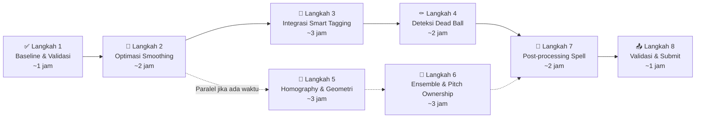

# 🏟️ Rancangan Strategi: More Than a Hack 2027

> **Deadline:** 17 November 2026 — **Tersisa: 2 hari!** Prioritaskan langkah cepat yang berdampak besar.

---

## 🧭 Konteks & Tujuan

**Tantangan:** Untuk setiap frame video pertandingan LaLiga (199.319 frame), tentukan status penguasaan bola — tim tuan rumah (`H`), tim tamu (`A`), bola mati (`D`), atau abstain (`X`).

**Metrik Kunci:**
- 🏆 **`spellF1`** — Metrik ranking utama. Menilai seberapa banyak **possession spell** (rangkaian kepemilikan bola utuh) yang berhasil diidentifikasi menggunakan pencocokan *temporal IoU*, bukan sekadar akurasi per frame.
- 📊 **`macroF1`** — Tie-breaker. Rata-rata F1 per kelas (`H`, `A`, `D`) yang dihitung secara *frame-exact*.

**Baseline yang Harus Dilampaui:** `spellF1 = 0.2433` (baseline_smooth50 pada repositori resmi)

**Data yang Tersedia:**
| Data | Keterangan |
|---|---|
| ATD (Automatic Tracking Data) | Posisi & kecepatan semua pemain + bola, 25 fps. Bola **hanya terdeteksi 56.9%** frame |
| Smart Tagging | Anotasi taktis otomatis: fase permainan & set piece, per interval waktu |
| Homography | Matriks proyeksi kamera ↔ koordinat lapangan (piksel ke meter) |
| Video Taktis & Broadcast | Dua rekaman kamera (video tidak wajib diproses langsung) |
| Ground Truth Publik | 5 menit pertama = 7.500 frame = 17 possession riil |

---

## 🔑 Insight Kritis

> [!IMPORTANT]
> **`spellF1` ≠ `macroF1`**: Mengoptimalkan akurasi per frame sering kali mengorbankan struktur penguasaan. Prediksi yang berfluktuasi cepat (*flickering*) menghasilkan puluhan penguasaan semu yang menghancurkan skor `spellF1`.

> [!NOTE]
> **Label `X` Bekerja sebagai Forward-Fill**: Evaluator memperlakukan `X` sebagai pengulangan label sebelumnya di dalam babak yang sama. Gunakan `X` di tengah kepemilikan bola saat pelacakan bola hilang agar tidak memutus rangkaian penguasaan.

> [!WARNING]
> **Hindari Overfitting pada 5 Menit Publik**: Data ground truth publik hanya mencakup 17 possession. Optimasi harus berlandaskan prinsip teoritis sepak bola dan pemodelan yang konsisten di seluruh pertandingan penuh.

---

## 📋 Langkah-langkah Strategis & Poin Implementasi Referensi

### Langkah 1 — Kuasai Baseline & Pipeline Validasi

* **Konsep Utama:** Membangun fondasi evaluasi yang dapat diandalkan secara lokal untuk mereplikasi penilaian resmi sebelum menguji metode yang lebih kompleks.
* **Poin Implementasi dari Referensi:**
  * **Protokol Benchmarking Berlapis (*Vidal-Codina et al., 2022*):** Mengadopsi prinsip evaluasi bertahap, memverifikasi konsistensi format dan keselarasan temporal antara sinyal pelacakan kontinu (25 Hz) dan indeks frame video diskret.
  * **Karakterisasi Baseline & Noise Floor (*Kim et al., 2026 - PathCRF*):** Menjadikan model heuristik independen per-frame sebagai tolok ukur dasar untuk mengukur seberapa besar kesalahan yang diakibatkan oleh pergantian label yang tidak wajar.

---

### Langkah 2 — Perbaiki Smoothing Window & Pemodelan Temporal

* **Konsep Utama:** Mengeliminasi fluktuasi cepat (*flickering*) antartim dengan memodelkan kontinuitas waktu penguasaan bola.
* **Poin Implementasi dari Referensi:**
  * **Konsep Team Playmaking (*Link & Hoernig, 2017*):** Penguasaan tim tidak hanya mencakup momen kaki bersentuhan dengan bola, melainkan mencakup fase bola meluncur di antara rekan satu tim (*void phase / pass in flight*). Jendela waktu harus cukup lebar untuk mencakup jeda operan normal.
  * **Penalti Transisi Tak Wajar (*Kim et al., 2026 - PathCRF*):** Menerapkan aturan transisi sekuensial (prinsip Viterbi/CRF) yang melarang perpindahan kepemilikan bola seketika antarlawan tanpa ada fase perebutan atau operan perantara, sehingga transisi palsu dapat ditekan secara sistematis.

---

### Langkah 3 — Integrasikan Smart Tagging sebagai Prior Kontekstual

* **Konsep Utama:** Menggunakan informasi makro tentang fase taktis dan kejadian pertandingan sebagai distribusi prior untuk memperjelas situasi ambigu, terutama saat bola tidak terdeteksi.
* **Poin Implementasi dari Referensi:**
  * **Prior Berdasarkan Fase Taktis (*Renner et al., 2026*):** Struktur fase seperti *Build Up* atau *Progression* memiliki keterkaitan erat dengan kepemilikan tim tertentu. Konteks ini digunakan sebagai panduan arah saat pelacakan lokal tidak mencukupi.
  * **Penetapan Status Pasca-Bola Mati (*Metrica Sports Event Definitions*):** Kejadian bola mati (*set piece*) selalu menandai permulaan kepemilikan bola aktif oleh tim eksekutor. Informasi tim penendang/pelempar menjadi jangkar awal kepemilikan setelah fase bola mati selesai.

---

### Langkah 4 — Deteksi Dead Ball (`D`) dari Konfigurasi Spasial

* **Konsep Utama:** Mengenali saat permainan terhenti tanpa hanya bergantung pada ada/tidaknya koordinat bola, melainkan melalui perilaku kolektif pemain.
* **Poin Implementasi dari Referensi:**
  * **Pola Pemicu Bola Mati (*Set Piece Triggers - Vidal-Codina et al., 2022*):** Mengidentifikasi penghentian pertandingan berdasarkan formasi statis khas:
    * *Kickoff*: seluruh pemain berkumpul di area masing-masing dan ada pemain di titik tengah lapangan.
    * *Goal Kick*: pemain bertahan berada di kotak gawang kecil sementara pemain lawan berada di luar kotak penalti.
    * *Throw-in*: terdapat pemain yang posisinya berada di luar batas garis tepi lapangan.
  * **Model Keadaan Diskrit Perjalanan Bola (*Vorobev et al., 2025*):** Membedakan kondisi bola dalam permainan (*in-play*) dan kondisi di luar lapangan (*out-of-pitch*), mengenali jeda waktu antara bola keluar lapangan hingga dimulainya kembali permainan.

---

### Langkah 5 — Optimalkan dengan Geometri Lapangan Nyata (Homography)

* **Konsep Utama:** Memanfaatkan koordinat metrik lapangan nyata untuk menghitung kedekatan fisik dan interaksi dinamis antara pemain dan bola secara presisi.
* **Poin Implementasi dari Referensi:**
  * **Zona Penguasaan (*Possession Zone - Vidal-Codina et al., 2022*):** Menentukan batas lingkaran pengaruh fisik di sekitar pemain (radius fisik sekitar 1 meter) untuk mendefinisikan interaksi bola nyata.
  * **Zona Perebutan (*Duel Zone - Vidal-Codina et al., 2022 & Metrica Sports*):** Mengidentifikasi situasi perebutan ketika pemain dari kedua tim berada dalam jarak yang setara terhadap bola, di mana penguasaan bola tetap berada pada tim sebelumnya hingga lawan benar-benar mengontrol bola.
  * **Validasi Kontrol Terhadap Defleksi (*Link & Hoernig, 2017*):** Membedakan sentuhan terkontrol dari sekadar bola yang melintas atau memantul (*deflection*) melalui perubahan signifikan pada vektor arah dan akselerasi bola.

---

### Langkah 6 — Voting / Ensemble Berbagai Sinyal Spasial & Taktis

* **Konsep Utama:** Menggabungkan bukti dari berbagai sudut pandang (kedekatan geometris, dominasi ruang, dan struktur formasi tim) menjadi satu keputusan kepemilikan yang tangguh.
* **Poin Implementasi dari Referensi:**
  * **Pitch Ownership Cepat Berbasis Tetangga Terdekat (*Mendes-Neves et al., 2025 - KNN Pitch Control*):** Menghitung penguasaan wilayah lapangan dengan memperhitungkan kecepatan dan arah lari pemain untuk memproyeksikan siapa yang mengontrol area bola saat bola mengalami oklusi.
  * **Pengaruh Kedalaman Garis Formasi (*Renner et al., 2026*):** Menggunakan distribusi posisi horizontal tim (kedalaman lini pertahanan dan blok penyerangan) sebagai sinyal pendukung untuk membedakan tim yang sedang menguasai bola dari tim yang sedang bertahan.

---

### Langkah 7 — Post-Processing Khusus untuk Metrik `spellF1`

* **Konsep Utama:** Menyelaraskan hasil akhir dengan karakteristik statistik penguasaan bola sepak bola nyata guna memaksimalkan skor pada evaluasi berbasis segmen temporal.
* **Poin Implementasi dari Referensi:**
  * **Filter Durasi Minimum Penguasaan (*Yamamoto et al., 2024*):** Analisis empiris menunjukkan bahwa rangkaian kepemilikan bola tim mengikuti distribusi waktu dengan durasi rata-rata yang jauh melampaui beberapa detik. Segmen penguasaan mikro yang terlalu pendek dianggap sebagai anomali (*spurious prediction*) dan disatukan ke segmen dominan di sekitarnya.
  * **Pemanfaatan Strategis Status Abstain (`X`):** Menggunakan label `X` pada celah oklusi di tengah rangkaian penguasaan satu tim untuk menghindari pemecahan segmen yang tidak perlu, dengan tetap mempertahankan label tegas pada momen transisi pergantian tim.

---

### Langkah 8 — Validasi & Finalisasi Deliverable

* **Konsep Utama:** Memastikan keluaran akhir memenuhi seluruh standar teknis dan regulasi kompetisi tanpa kesalahan struktural.
* **Poin Implementasi dari Referensi:**
  * **Verifikasi Integritas Data & Konsistensi Evaluasi:** Menjalankan pengecekan format dan evaluasi komparatif lengkap (memantau `spellF1`, `macroF1`, rasio fragmentasi, dan latensi transisi) untuk memastikan stabilitas hasil sebelum batas akhir pengumpulan.

---

## 🗂️ Urutan Prioritas (dengan deadline 2 hari)

---

## 🛠️ Bahan & Alat yang Perlu Disiapkan

### Dependencies Python
- `numpy`, `pandas`, `matplotlib`, `kloppy`, `scipy` (tersedia di lingkungan proyek)

### Berkas Kunci yang Digunakan
| Berkas | Fungsi |
|---|---|
| [`starter/baseline.py`](file:///home/luqman_46/hack_barca/more-than-a-hack-2027/starter/baseline.py) | Algoritma dasar penentuan pemain terdekat |
| [`starter/load_atd.py`](file:///home/luqman_46/hack_barca/more-than-a-hack-2027/starter/load_atd.py) | Pemuatan data tracking koordinat pemain dan bola |
| [`starter/load_smart_tagging.py`](file:///home/luqman_46/hack_barca/more-than-a-hack-2027/starter/load_smart_tagging.py) | Pemuatan anotasi fase taktis dan set piece |
| [`starter/load_homography.py`](file:///home/luqman_46/hack_barca/more-than-a-hack-2027/starter/load_homography.py) | Proyeksi koordinat kamera ke lapangan nyata |
| [`evaluation/run_evaluation.py`](file:///home/luqman_46/hack_barca/more-than-a-hack-2027/evaluation/run_evaluation.py) | Skrip evaluasi skor lokal |
| [`evaluation/validate_submission.py`](file:///home/luqman_46/hack_barca/more-than-a-hack-2027/evaluation/validate_submission.py) | Skrip validasi integritas file submission |
| [`referensi/`](file:///home/luqman_46/hack_barca/more-than-a-hack-2027/referensi) | Folder pustaka referensi akademik & dokumentasi resmi |

---

## 📌 Ekspektasi Peningkatan (Estimasi)

| Langkah | Estimasi `spellF1` | Risiko |
|---|---|---|
| Baseline (floor) | 0.2433 | — |
| + Smoothing optimal & kontrol transisi | 0.28–0.35 | Rendah |
| + Integrasi Smart Tagging (prior tim) | 0.35–0.45 | Sedang |
| + Deteksi dead ball spasial | 0.40–0.50 | Sedang |
| + Post-processing spell (pruning segmen mikro) | 0.45–0.55 | Sedang–Tinggi |
